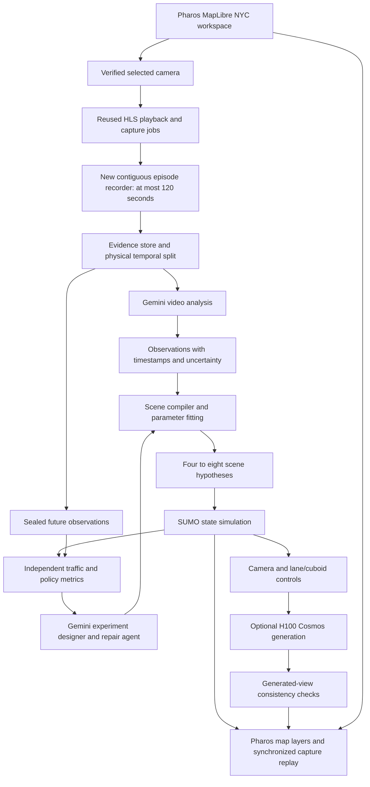

# Gotham Forge

**Turn up to two minutes of NYC camera footage into an editable traffic simulation, then use Gemini 4 to find and repair failures.**

This is the complete implementation plan for a four-person, eight-hour build with four H100 GPUs. The available inputs are continuous NYC camera video and periodic NYC DOT snapshots. The immediate perception pipeline uses Gemini to interpret the footage. Local detection/tracking and learned dynamics are later extensions.

**Implementation foundation:** reuse the existing [Pharos project](https://github.com/Divyesh-Thirukonda/pharos) for its NYC geographic rendering, camera selection, HLS playback, captured-video overlays, and asynchronous analysis-job pipeline. Extend that working architecture with a Gemini scene compiler and simulation services. Retain React, TypeScript, Vite, MapLibre, and FastAPI instead of rebuilding the camera application.

**Status (November 19, 2026):** the initial UI slice is implemented: a geographic NYC map, a deterministic illustrative Vestry traffic demo, City/Intersection/Follow views, and toggleable public camera feeds. Pharos architecture was adapted from commit `5bd6fd9ba4dcd206c96e5c9c15f37b96fcf42f1a`, retaining attribution. The production build, six frontend tests, and 19 backend tests pass; local browser review verified live Vestry playback and measured render activity. See [setup and controls](RUNNING.md), [architecture](docs/ARCHITECTURE.md), and the [verification record](docs/VERIFICATION.md). Camera-grounded reconstruction, Gemini/SUMO execution, model endpoint smoke tests, generated video, and evaluation are not implemented. The numerical budgets and acceptance thresholds below remain proposed targets for that broader system. Model/API references were checked on November 18, 2026; actual account access, quotas, GPU memory, and runtime compatibility remain integration checks. Historical Pharos results do not validate the Gemini migration.

## 1. The idea and the intended result

Gotham Forge combines **Gotham Gym**, the camera-derived traffic benchmark, with **Red Team City**, the adversarial scenario generator, from the supplied [traffic twin idea notes](06-nyc-traffic-twin-robotaxi.md). The [camera notes](05-nyc-dot-cameras.md) and [benchmark notes](07-evals-benchmarks-research.md) provide background. Their recommendations are research material; this README defines the implementation scope.

The product loop is:

1. Select the actual camera in the Pharos NYC view and give Gemini a short video of that intersection.
2. Extract an evidence-linked description of the roads, traffic controls, counts, queues, movements, and uncertainty.
3. Compile that description into a reproducible simulation whose visible traffic patterns agree with the footage.
4. Let a user change the world through language: move a delivery van, vary cyclist emergence timing, or alter an approach's demand.
5. Search the resulting worlds for a plausible failure of a driving policy.
6. Ask Gemini to propose a bounded policy repair.
7. Evaluate the repair on withheld cases and show both failure reduction and traffic progress.

The core promise is **a plausible local NYC traffic simulation from a small amount of evidence, with explicit uncertainty and executable interventions**. One short clip describes one location and observation window. It cannot establish representative traffic demand for all of NYC.

The first successful result should reproduce recognizable local patterns: which approaches are occupied, where queues form, which movements occur, when observed signals change, and how a blockage affects traffic. The counterfactual experiment builds on that result.

The first failure family is a stopped van or bus obscuring a cyclist near a crossing. If the supplied clip supports a different clear mechanism, use a blocked lane, merging vehicle, or turning vehicle interacting with pedestrians. Record which actors/events were actually observed and which were deliberately inserted.

## 2. The Waymo reference and the gaps we must close

Waymo's February 2026 article describes a world model based on Genie 3, adapted to driving. It generates camera and LiDAR observations, supports action, scene-layout, and language control, converts ordinary camera recordings into simulation, and describes an efficient variant for longer rollouts. These are the capabilities that motivate this project. [Waymo World Model](https://waymo.com/blog/2026/02/the-waymo-world-model-a-new-frontier-for-autonomous-driving-simulation/)

The following comparison is our engineering assessment. The article is a capability demonstration, not a reproducible implementation package for this project. An item marked unknown means the cited article does not establish it for us; it is not a claim that Waymo lacks the capability.

| Dimension | Reference capability or disclosure | Gap in our starting position | Eight-hour response | Remaining research problem |
|---|---|---|---|---|
| Data | Driving-domain post-training | Our footage may be fixed, low-resolution, monocular, and short | Use one stable view; infer only observable traffic summaries | Broader geography, weather, and behavior coverage |
| Geometry | Multimodal driving scenes | Camera pose, metric scale, hidden geometry, and actor state are uncertain | Verified road-plane calibration and simple actor footprints | Consistent 3D reconstruction beyond the visible road |
| Sensors | Camera and LiDAR generation | We have camera evidence without measured local LiDAR | Treat geometry and any generated depth as separate evidence classes | Validate synthetic sensors against measured sensors |
| Control | Action, layout, and language controls | A video description alone cannot execute an intervention | Typed scene edits and deterministic state transitions | Reliable control over long neural rollouts |
| Interaction | Action-responsive simulation | Observed behavior does not identify responses to new ego actions | Reactive simulator actors and explicit behavior assumptions | Learn and validate counterfactual human reactions |
| Appearance | Photorealistic outputs | A traffic simulation initially renders simplified geometry | Parallel pretrained Cosmos integration and optional Omni variants | Preserve identities, signals, and geometry under generation |
| Duration | Efficient longer rollouts | Our evidence covers at most two minutes | Evaluate short forecasts and bounded scenario rollouts | Long-horizon stability and uncertainty growth |
| Access | Proprietary system described publicly | No Waymo model endpoint or weights established | Independent implementation using Gemini, SUMO, and available models | Reproduce useful capabilities without proprietary internals |
| Evaluation | Demonstrations and qualitative examples in the article | No directly transferable acceptance test for our NYC reconstruction | Publish observable errors, seeds, policy outcomes, and ablations | Establish external validity on diverse held-out scenes |

The opportunity is an **evidence-to-experiment interface**: Gemini can interpret ambiguous footage, maintain multiple plausible worlds, choose useful follow-up observations, and design tests whose outcomes are computed by an independent simulator. Whether this combination improves sample efficiency is an experiment, not an established novelty claim.

Three gaps are especially consequential:

- **Identifiability:** the same visible queue can result from different arrival rates, signal phases, or downstream constraints. Preserve alternatives rather than silently selecting one explanation.
- **Closed-loop validity:** recorded future trajectories cannot describe how other actors react to a newly controlled vehicle. Reactive behavior must be modeled and its assumptions exposed.
- **Measurement validity:** visual similarity does not establish correct flow, timing, geometry, or policy safety. Evaluate those quantities directly.

### Additional research context: SceneDiffuser++

[SceneDiffuser++: City-Scale Traffic Simulation via a Generative World Model](https://arxiv.org/pdf/2506.21976v1) (Tan et al., 2025, v1) complements the Waymo reference with a semantic-state simulator. Section 3 jointly models actors and traffic lights through conditional multi-tensor diffusion. A predicted validity channel handles entry, exit, and occlusion; masked supervision and validity-weighted soft clipping support sparse states. Section 4.1 separates planner/world-model executions and evaluates distributions over long rollouts. This paper and the February 2026 Waymo World Model announcement describe distinct systems.

Its training uses a large WOMD corpus; evaluation uses expanded maps. Short training clips do not establish learning citywide dynamics from one NYC recording. Treat it as architectural context, with checkpoint availability unverified.

**Our implementation decisions:** retain Gemini extraction and SUMO within eight hours. In Sections 8–10, add an actor entry/exit ledger and separate physical existence from camera visibility: an occluded actor persists. Keep future simulator predictions inaccessible to the driving policy. In Section 14, check actor conservation, boundary flows, and signal transitions against observable held-out evidence. Extend distributional realism tests across independent episodes later; diffusion training stays in Section 20's research roadmap.

## 3. Scope and success conditions

### Required in eight hours

- One intersection and its immediate visible approaches.
- Reused Pharos NYC map, feed selection, live playback, and captured-video overlay components.
- One continuous clip, with **120 seconds maximum total source duration per reconstruction episode**.
- Gemini-first extraction of road semantics and traffic observations.
- A small, manually checked camera calibration.
- Four to eight plausible scene/parameter hypotheses.
- A validated scene specification and reproducible SUMO simulation.
- A synchronized captured-video replay and MapLibre simulation overlay, with camera-matched geometry where calibration supports it.
- A short held-out traffic-pattern check.
- One bounded intervention family, deterministic failure replay, and policy repair test.
- Actual measurement tables, evidence references, and recorded experiment versions.

### Parallel stretch work

- One controlled neural camera view using a pretrained Cosmos checkpoint.
- Gemini Live voice commands.
- Decisions API semantic checks and a Robotics ER comparison.
- A second short clip for generalization, with its own independent 120-second cap.

### Subsequent work

- Multi-intersection networks and fleet dispatch.
- Continuous cross-camera identity tracking.
- A calibrated learned model of interactive human behavior.
- Training or fine-tuning large video world models.
- Multi-camera plus LiDAR generation and validation.
- Claims about citywide congestion, real-world AV safety, or unobserved policy outcomes.

Success has two levels. **Level A** is a camera-grounded simulation with an honest fidelity report. **Level B** adds counterexample discovery and a repair that improves withheld simulated cases while preserving progress. Neural rendering adds a visual and perception-testing capability after its controls are validated.

## 4. Architecture and Pharos reuse

### Reusable foundation, verified from source

Use [Pharos commit `5bd6fd9`](https://github.com/Divyesh-Thirukonda/pharos/tree/5bd6fd9ba4dcd206c96e5c9c15f37b96fcf42f1a) as the reference base. The file links below are pinned to that revision. The reuse inventory comes from code inspection; current feed availability and runtime health still require smoke tests.

| Existing component | Verified responsibility | Gotham Forge change |
|---|---|---|
| [src/CityMap.tsx](https://github.com/Divyesh-Thirukonda/pharos/blob/5bd6fd9ba4dcd206c96e5c9c15f37b96fcf42f1a/src/CityMap.tsx) | MapLibre/OpenFreeMap NYC view, extruded buildings, camera markers, selection, fly-to, tilt, historical heat layer | Retain the map and add explicit scene, queue, actor, trajectory, and uncertainty layers |
| [src/LiveObserver.tsx](https://github.com/Divyesh-Thirukonda/pharos/blob/5bd6fd9ba4dcd206c96e5c9c15f37b96fcf42f1a/src/LiveObserver.tsx) | HLS playback, `CapturedVideo` SVG overlays, `VisionAnalysis` job submission/polling, monitoring and previous-result display | Reuse playback and lifecycle; add Gemini observations, episode creation, and synchronized simulation replay |
| [src/App.tsx](https://github.com/Divyesh-Thirukonda/pharos/blob/5bd6fd9ba4dcd206c96e5c9c15f37b96fcf42f1a/src/App.tsx) | City/camera/review composition, source selection, still refresh, archive review, connection status | Add “Simulate this window” and a compact experiment panel within the existing shell |
| [src/vision.ts](https://github.com/Divyesh-Thirukonda/pharos/blob/5bd6fd9ba4dcd206c96e5c9c15f37b96fcf42f1a/src/vision.ts) and [src/types.ts](https://github.com/Divyesh-Thirukonda/pharos/blob/5bd6fd9ba4dcd206c96e5c9c15f37b96fcf42f1a/src/types.ts) | Camera, clip, job, media, timing, model, and normalized-image tracking contracts | Preserve provenance; add separate observation, calibration, scene, and rollout types |
| [backend/vision.py](https://github.com/Divyesh-Thirukonda/pharos/blob/5bd6fd9ba4dcd206c96e5c9c15f37b96fcf42f1a/backend/vision.py) | Trusted camera sources, FFmpeg capture, job queue, analyzed-media serving, inference stages, validation, cleanup | Retain transport/lifecycle; replace mandatory legacy inference with Gemini and add a bounded episode recorder |
| [backend/main.py](https://github.com/Divyesh-Thirukonda/pharos/blob/5bd6fd9ba4dcd206c96e5c9c15f37b96fcf42f1a/backend/main.py) | Public camera and intersection APIs, caching, archive media proxy, service status, deployment integration | Keep useful source adapters; add Gemini operation status and simulation routes |
| [backend/tracking.py](https://github.com/Divyesh-Thirukonda/pharos/blob/5bd6fd9ba4dcd206c96e5c9c15f37b96fcf42f1a/backend/tracking.py) and [backend/nearmiss.py](https://github.com/Divyesh-Thirukonda/pharos/blob/5bd6fd9ba4dcd206c96e5c9c15f37b96fcf42f1a/backend/nearmiss.py) | Existing image-space tracks/projections and approximate conflict candidates | Preserve only as explicitly labeled optional diagnostics; build calibrated simulator metrics separately |

Pharos renders building massing and geographic layers. Its live video is displayed in a panel; its captured-video boxes and trails are synchronized SVG overlays. It does not already project video onto calibrated 3D streets or provide a learned traffic simulator. These are separate capabilities with separate geometry requirements.

The earlier Cosmos integration performs video reasoning. Replace that role with Gemini. The optional H100 Cosmos **Sim-Auto generation** path in this plan is a new service with a different model and input/output contract.

### NYC rendering and feed overlays

Keep the existing MapLibre style, building extrusion, map controls, camera hit-testing, responsive panel, and attribution. Preserve existing third-party notices when bringing source into this project. A citywide map can remain visible while only one selected intersection is simulated.

Add distinct map sources for:

- `scene-lanes` and `scene-crosswalks`: calibrated local geometry transformed into map coordinates.
- `scene-queues`: measured queue intervals with their observation time and visibility limits.
- `sim-actors`: oriented actor footprints for the selected branch and simulation time.
- `sim-trajectories`: completed or predicted paths, labeled by branch and provenance.
- `scene-occlusions`: assumed/derived visibility masks and uncertain areas.
- `experiment-markers`: selected failures and repair comparisons with experiment IDs.

Keep the existing historical crash heat layer independent of live observations and simulated outcomes. Building footprints and camera registry coordinates provide geographic context; they do not establish camera pose, lane geometry, or current risk.

Reuse `LivePlayer` for the advancing HLS stream and `CapturedVideo` for the exact analyzed window. Add lane polygons, count lines, signal observations, and selected projected simulator tracks to the replay overlay. Label observed, derived, inserted, and generated content distinctly. Do not place boxes from a completed job over a newer live stream frame.

The selected camera can expose its feed in the existing panel or a new map-anchored card using the same player. Keep one active live decoder by default, with still thumbnails for other cameras. A feed card is a UI overlay at a camera location, distinct from physically projecting the video onto the street. Send only the selected simulation branch to the map; thousands of search branches stay on the backend, represented in the UI by summaries and selected replays.

Join synchronized overlays by `cameraId`, capture hash, `episodeId`, `sceneVersion`, `calibrationId`, `branchId`, and relative replay time. Keep source capture time, server acquisition time, model completion time, and simulation time separate. Display the age of the last completed analysis while a new job runs.

To connect the two views, add verified image-to-local-metric and local-metric-to-geographic transforms. Calibrate using landmarks that belong to the actual selected camera view. If geographic alignment is uncertain, show the local simulation in its own pane and retain the map as context. Unknown-location archive clips must not inherit the currently selected intersection's coordinates.

A camera-frustum or video-on-ground projection is optional after calibration. Flat image draping cannot recover vertical buildings or occluded road surfaces. For the first demo, MapLibre actor polygons and synchronized replay overlays are sufficient; a Three.js custom layer is an optional later renderer, not a replacement for the Pharos map.

### Preserve the camera's actual location

The inspected Pharos source distinguishes the DOT still at Sixth Avenue/West 23rd Street from nearby continuous West Street feeds. Those feeds show different intersections. Prefer an actually visible continuous source, such as the existing Vestry Street or West Street camera entries, after rechecking availability and useful coverage. Move the selected scene/map focus to that source. The earlier project's [source inventory](https://github.com/Divyesh-Thirukonda/pharos/blob/5bd6fd9ba4dcd206c96e5c9c15f37b96fcf42f1a/design/data-sources.md) documents the distinction; its historical availability checks must not be presented as current checks.

### Reuse the capture pipeline and replace its analysis stages

The inspected `backend/vision.py` captures **four seconds for live jobs and eight seconds for recorded jobs**, transcodes at **8 FPS and up to 640 pixels wide**, and exposes asynchronous jobs plus the saved analyzed MP4. Frontend monitoring requests the next window after the previous job finishes and pauses new work when hidden. This is repeated window analysis; polling every second does not mean inference runs every second. The code values take precedence over older prose in the Pharos README.

Preserve allowlisted sources, capture hashes, relative timestamps, queued/capturing/analyzing/completed/failed states, error reporting, bounded concurrency, media replay, and visibility-aware monitoring. Retain the existing polling transport during the hackathon.

Replace the mandatory `run_cosmos`/`run_yolo`/`assess_fresh_video` sequence with a provider-aware Gemini path: upload the permitted calibration media, extract observations, validate them, compile a scene, and publish the result. Update `settings_status`, `create_job`, `perform_job`, `guarded_stage`, `/api/health`, and `/api/system/status` together; otherwise Gemini jobs would remain blocked by the old Cosmos/YOLO credential requirements. Retain the configured/unverified/connected/stale/unavailable distinction using actual Gemini operations. W&B assessment, VSS archive retrieval, and YOLO must not be mandatory dependencies of the new live-camera path.

Add Gemini-specific result fields and preserve actual model IDs, input hashes, inspected intervals, request IDs, token usage, and latency. Do not write Gemini output into fields named `cosmosObservation` or label Gemini observations as YOLO detections. Optional frame-specific boxes need an explicit coordinate convention and timestamp mapping; traffic count/queue observations remain a separate schema. The existing normalized-image tracks and approximate near-miss values cannot be promoted into metric simulation truth.

Retain temporal evidence and schema validation, but update `apply_evidence_guards` and related UI checks to read the new observation contract. Give a Gemini verifier the permitted source frames/clip, not only the first model's narrative. A Gemini-only result may contain sparse boxes, ROI counts, and event intervals without dense trajectories; disable dense-track projections when the necessary evidence is absent. Model-generated confidence fields must not masquerade as calibrated detector probabilities.

The optional archive/history paths have additional W&B calls in [backend/search.py](https://github.com/Divyesh-Thirukonda/pharos/blob/5bd6fd9ba4dcd206c96e5c9c15f37b96fcf42f1a/backend/search.py) and `main.infer_assessment`. If those paths are retained, migrate their planning/assessment separately or show them as unavailable. Keep archive retrieval outside the critical scene-building path; optional Embedding 2 retrieval can be added later. Pharos's existing optional tracing remains independent of the observation provider.

Use Gemini function calls for evidence inspection and scenario jobs. Gemini Live can provide voice interaction or coarse observation, while normal video analysis handles bounded clips. Neither API needs to replace HLS transport or the local physics clock.

### Add a genuine episode recorder

Keep short monitoring jobs for previews. Add a separate episode workflow that captures a contiguous source interval of at most 120 seconds and physically separates calibration media from held-out media. Repeated four-second jobs can have inference-dependent gaps; never concatenate them into a supposedly continuous two-minute clip without preserving those gaps.

Capture may continue independently of inference within the bounded buffer. Stop at the cap, on cancellation, or when the source fails; record discontinuities and actual duration. A model-side retry reuses saved bytes rather than starting another capture. Deduplication keys must include source, interval/hash, mode, split, provider/model, and prompt version rather than only source ID and question text.

Audit existing bounds before enabling longer episodes: the source currently limits analyzed video to 8 MiB, source downloads to 40 MiB, cached jobs to 24/150 MiB with a 30-minute cleanup target, concurrent work to two active plus four queued jobs, FFmpeg execution to a 50-second default timeout, and the total job to 330 seconds. Its detector normalization also truncates to 68 frames. Simply changing the capture duration would produce timeouts, truncated evidence, or early eviction. Introduce independently configurable duration, byte, timeout, and retention budgets; report actual duration if any limit ends capture early. Any optional detector adapter must use the episode metadata rather than the old fixed-frame cap.

Preserve a source-quality master for the selected episode where available and create lower-rate Gemini proxies separately. An 8-FPS transcode cannot support a later claim of 12-FPS evidence. For recorded clips, implement an explicit requested start/end interval and source-time mapping; the inspected archive capture does not seek to the requested event interval before its short extraction.

Pin an episode's media and metadata while calibration, evaluation, or rendering jobs reference it, within a bounded experiment-storage budget. Store final reproducibility artifacts separately from Pharos's short-lived review cache: its job registry is in memory and cleanup removes orphaned files after a restart. A small persistent manifest store is enough for the hackathon; object storage/database services are optional deployment choices. Keep held-out media inaccessible to scene-building tools even though it is part of the same recorded episode. If a source frame lacks an original capture clock, display server acquisition time and unknown broadcast delay.

Isolate each episode's agent context as well as its media permissions. Ongoing monitoring and “latest camera” tools must not inject post-cutoff observations into a sealed forecast or repair. Earlier monitoring can help a human select the source, but the compiler may consume only evidence inside the episode's permitted prefix; do not silently carry previous raw observations into a claimed two-minute reconstruction. All overlapping derivatives inherit their source interval's split assignment.

### Route and contract migration

The following new routes are proposed contracts, not existing Pharos endpoints:

| Route | Plan |
|---|---|
| Existing `GET /api/cameras` and `GET /api/vision/cameras` | Retain still/continuous source separation and source metadata |
| Existing `POST /api/vision/jobs`, `GET /api/vision/jobs/{id}`, and job media route | Retain bounded monitoring/replay with provider-aware Gemini jobs |
| New `POST /api/episodes` and `GET /api/episodes/{id}` | Capture/import the selected interval, enforce the cap/split, expose progress and evidence metadata |
| New `POST /api/episodes/{id}/scenes` | Compile or revise a scene from allowed prefix observations |
| New `POST /api/scenes/{id}/runs` and `GET /api/runs/{id}` | Execute immutable baseline/intervention/repair branches and expose replay artifacts |
| New `GET /api/episodes/{id}/evaluation` | Publish sealed forecasts and permitted evaluation results after the cutoff |

Add `ObservationBatch`, `Calibration`, `SceneBelief`, `SimulationRun`, and `EvaluationResult` alongside the existing `VisionJob` contract. UI and tool clients must receive the same IDs and provenance. Preserve base-path-aware API/media URL handling for Pharos's deployment layout.



Use four logical layers:

| Layer | Owns | Produces |
|---|---|---|
| Evidence | Original media, timestamps, source hashes, split permissions | Immutable observations and provenance |
| Belief and compilation | Gemini hypotheses, camera calibration, parameter fitting | Validated scene specifications and weights |
| Execution | State transitions, reactive actors, controllers, random seeds | Reproducible trajectories and event logs |
| Evaluation and presentation | Independent metrics, controlled visualization, comparisons | Fidelity reports, counterexamples, repair results |

Gemini proposes interpretations, experiments, and edits. Ordinary code enforces units, tool boundaries, geometry, and evaluation rules. A generated explanation cannot certify the scenario it describes.

## 5. The short-footage input contract

The default episode is **120 seconds: 90 seconds for reconstruction and calibration, followed by 30 sealed seconds for evaluation**. A shorter episode is encouraged when adequate: 60 seconds can use a 40/20 split, and 30 seconds can use 20/10 with a stronger uncertainty warning.

The cap counts source duration, not upload size. If multiple videos are included in one episode, their durations sum to at most 120 seconds. Re-inspecting an existing crop or interval does not add new source time, but it does consume API budget. The main build uses one camera; multiple-camera alignment is an extension.

Physically split calibration and evaluation media into different files before model upload. Upload only the calibration file to the scene-building agent. Merely instructing an agent to ignore the end of an accessible video is not an adequate split. Any evaluator that reads the held-out clip uses isolated state and does not feed its contents back into the fitted episode.

For a live feed, maintain a bounded rolling buffer and create a new immutable episode when refreshing the scene. Each evaluation branch retains its original state and cutoff. A refreshed estimate becomes a new scene version; it does not retroactively alter a running experiment.

An initial 10–20-second prefix can produce a provisional layout and occupancy estimate while more evidence arrives. Measure time to first valid scene and time to each revision. Additional footage may refine the estimate only up to the episode cap and its calibration cutoff. For prospective live evaluation, issue the forecast before the evaluation frames arrive, score it, and then allow those frames to inform a new episode.

Record:

- Camera ID, source URL or file reference, and clip hash.
- Capture timestamps when known, fetch timestamps, and timestamp uncertainty.
- Duration, resolution, source frame rate, and effective unique-frame cadence.
- Camera pose epoch: a pan, tilt, zoom, or major scene change begins a new calibration epoch.
- Whether frames are continuous video, independent snapshots, or duplicated stills.
- Calibration/evaluation boundaries and all evidence-access logs.

NYC DOT describes its public service as frequently updated still images, notes that cameras can be repositioned, and says its cameras do not record footage. Public snapshots provide present observations; the supplied continuous recordings are a separate input. [NYC DOT camera information](https://www.nyc.gov/html/dot/html/motorist/atis.shtml)

The camera-list and image endpoints in the original notes can be checked during implementation, but camera counts, resolution, availability, and refresh cadence should be measured again. Cache repeated requests and retain actual timestamps. Polling a repeated still more frequently does not create additional motion evidence.

## 6. Gemini-first camera processing

Gemini is the immediate perception component. FFmpeg may decode, trim, timestamp, and crop video; OpenCV may support coordinate transformations. Neither replaces Gemini's semantic analysis in this version. A dedicated detector/tracker becomes an optional comparison or later optimization.

Implement these passes behind the reused Pharos job lifecycle. The observer produces new evidence/scene contracts, while the frontend retains its pending/error/last-completed states. The live source player continues independently; the result overlays always attach to the saved analyzed media. A monitoring window can help select a scene, but the final episode's traffic fit and holdout use its own contiguous, capped recording.

The current video API supports explicit static sampling and agentic exploration. Default static processing is 1 FPS; short clips suit explicit sampling, while higher-rate event inspection can resolve fast changes. Use the source's actual information content as the upper bound. [Gemini video understanding](https://aistudio.google.com/docs/video-understanding)

### Pass 1: scene layout and observability

Give Hydrogen or the selected Neon/Argon compiler a few timestamped prefix frames and the calibration video. Request:

- Road approaches, visible lane regions, approximate lane directions, crosswalks, stop lines, and curb boundaries.
- Vehicle classes, visible obstructions, and pedestrian/cyclist regions.
- Visible signal heads and which movements they appear to control.
- Counting gates and regions of interest that remain visible throughout the clip.
- Occluded regions, ambiguous geometry, unreliable timestamps, and quantities that cannot be estimated.

Gemini proposes image coordinates and evidence frames. A teammate confirms the small set of points used for metric calibration. Unobserved lane connections and signal ownership remain hypotheses.

Define upstream entry gates separately from stop-line or downstream exit gates. They measure arrival and discharge respectively; a queue can discharge quickly while receiving few new arrivals. If an entry gate is outside the view, keep upstream demand uncertain.

### Pass 2: temporal traffic observations

Start with static sampling at 2 FPS; increase to 4 FPS only if the observations justify the additional input. Analyze bounded windows, such as 10–15 seconds, with a small overlap for continuity. Every result refers to the original timeline.

For each approach and observation window, request:

| Observation | Representation | Required evidence |
|---|---|---|
| Visible vehicle count | Count or lower/upper interval by class | Frame timestamps and ROI |
| Queue | Vehicle-count interval and optional visible extent | Stopped/slow classification with uncertainty |
| Occupancy | Fraction of the defined image ROI occupied | Same ROI definition across real and simulated views |
| Gate crossings | Individual events with time interval, direction, and class | Before/after timestamps around a fixed gate |
| Turning movement | Left/through/right event when continuously attributable | Entry and exit evidence; otherwise unknown |
| Signal state | Red/amber/green/unknown plus transition interval | Visible signal evidence and movement association |
| Blockage | Object, affected lane, start/end interval | Evidence frames and visibility limits |
| Selected actor positions | Image ground-contact points and ambiguity | Timestamped visible observations |

Give each extraction call a half-open owned interval, such as `[0,15)` or `[15,30)`, while allowing surrounding frames as context. Assign crossing events only to their owned interval; handle the final clip endpoint explicitly. For events whose timestamp interval straddles a boundary, resolve ownership once in the evidence ledger. Do not add counts across overlapping analysis windows. Deduplicate crossings using gate, direction, class, temporal overlap, and supporting frames. If actor identity is ambiguous, retain a count interval instead of forcing a unique ID.

Queue thresholds must be explicit. A provisional operational definition could use repeated low displacement near an approach, but uncertain geometry or sparse sampling requires a count interval rather than a precise speed-based label.

### Pass 3: targeted verification

Escalate only disputed or decision-critical observations to Carbon. For a count audit, first request an answer from the relevant crop and nearby frames without exposing the earlier count; then reconcile the two observations. For semantic diagnosis, include the conflicting interpretations explicitly. Bound this to approximately four to six follow-up inspections per episode during the prototype.

For a short ambiguous crossing, inspect an existing 2–5-second interval at 8–12 FPS when the source supports it. A snapshot feed cannot supply that cadence. Timestamp precision remains bounded by actual sampled evidence even when a model prints more decimal places.

Require abstention for hidden actor identity, unreadable signals, and unsupported measurements. A second Gemini model is a useful disagreement detector; it is not independent ground truth. Manually annotate a small fixed subset of visible counts, crossings, and landmarks for verification.

### Pass 4: compile observations into a traffic specification

The compiler receives the verified observations, calibration, and uncertainty. It emits scene geometry, initial queues, lane-specific arrivals, visible turning proportions, signal hypotheses, actor classes, and bounded behavior parameters.

Every material value carries one of these provenance labels:

| Label | Meaning |
|---|---|
| `observed` | Directly supported by an evidence frame or event interval |
| `derived` | Computed from observations and a stated calibration/model |
| `assumed` | Prior or hypothesis required to execute the simulation |
| `inserted` | Intentional counterfactual intervention |
| `generated` | Synthetic appearance or sensor output |

Keep the original observation and the derived simulator value separate. For example, a visible count of six vehicles may initialize a queue, while unobserved vehicles farther upstream remain uncertain.

### Proposed extraction request

The scene-analysis prompt should explicitly request: “Use only the supplied calibration media. Return timestamped observations for the provided lane regions and gates. Attach evidence to every event. Represent occluded or ambiguous counts as intervals and unreadable signals as unknown. Separate direct observations from inferred quantities. Identify the next crop or interval that would most reduce a consequential ambiguity.”

Use structured output schemas rather than parsing free-form narration. Validate all tool arguments and reject evidence references outside the episode's allowed prefix.

## 7. What two minutes can and cannot identify

The short-window restriction is part of the research question: how much useful simulation can Gemini construct from minimal observation?

| Quantity | Reasonable use of a short clip | Required limitation |
|---|---|---|
| Visible counts and occupancy | Initial state and visible loading | Hidden vehicles remain unknown |
| Queue buildup/discharge | Local pattern during observed phases | Queue tail may lie outside the frame |
| Boundary crossing rate | Local short-window arrival or departure estimate | A congested exit measures discharge, not upstream demand |
| Turning proportions | Conditional proportions among observed attributable movements | Small samples need smoothing and uncertainty |
| Signal transitions | Observed state changes and timing intervals | A partial phase does not identify the full program |
| Vehicle speed | Coarse derived estimate from reliable points and calibration | Perspective, timing, and identity errors propagate |
| Interaction mechanism | A plausible scenario grounded in visible evidence | One event does not identify a population behavior model |
| Long-term traffic demand | A scenario prior for exploration | No representative hourly/daily profile from this window |
| Cross-camera routes | Usually unavailable in the core setup | No assumed vehicle re-identification between cameras |
| Hidden geometry and LiDAR | Explicit synthetic hypotheses | No claim of measurement from monocular footage |

If only a partial traffic-light cycle is visible, preserve multiple compatible signal programs. If no signal is readable, separate an assumed control program from observed actor behavior. Multiple parameter sets may fit equally well; retain that ambiguity.

### Parameter estimation

Use lane-level crossing counts only where a gate's visibility and meaning are verified. For a fully observed arrival boundary, a simple engineering model is a Poisson arrival rate with a Gamma prior: observing `N` arrivals over `T` seconds updates shape by `N` and rate by `T`. This is a convenient uncertainty model, not a claim that NYC arrivals are always Poisson. Signal-released platoons may require phase-dependent arrivals or replaying observed headway patterns.

For turning proportions, use a Dirichlet prior and add only confidently attributed movement counts. A movement never observed in 90 seconds should retain a possible nonzero probability when the map permits it.

When the upstream boundary is obscured or saturated, do not use queue discharge as a direct estimate of latent demand. Hold multiple demand hypotheses and use visible queue change as an additional constraint. Mark camera coverage and detector/model uncertainty separately from variability in traffic itself.

Use vehicle conservation as a consistency check. For a fully visible fixed approach region, the next vehicle count should equal the previous count plus boundary arrivals minus departures, with lane exchanges accounted for. Partial visibility requires explicit occlusion/censoring terms. For the queued subset, count transitions into and out of the queue; vehicles crossing an upstream boundary do not necessarily join the queue immediately. Large unexplained residuals trigger evidence review instead of another free-form explanation.

### Fit a small parameter set

Optimize only parameters that the clip can constrain: initial queues, a few approach rates, observed movement proportions, partial signal timing, and a limited blockage description. Keep car-following and lane-changing parameters at declared priors unless the evidence supports changing them.

The fitting objective combines normalized count error, queue-interval error, visible occupancy error, observed crossing-count error, and observed signal mismatch. Include a regularization penalty for departures from prior ranges. Omit terms with inadequate evidence.

For interval observations, use distance to the interval: predictions inside the supported range incur zero interval violation. Give each metric an uncertainty scale so a one-vehicle error and a one-second error do not receive arbitrary equal weight. Report the individual components even when an optimizer uses their weighted sum.

Fit on early calibration bins, inspect a separate portion of the calibration prefix for model selection, then lock the result before opening the final holdout. If the prefix is too short to support an internal split, fix the configuration in advance and limit tuning rounds. The final held-out suffix stays sealed throughout reconstruction and repair of the traffic fit.

## 8. Geometry, scene state, and the compiler

Use a local metric coordinate frame centered on the intersection. Define meters, seconds, radians, and a documented axis orientation. Camera pixel coordinates use an explicit origin and normalization convention.

For the MVP, fit a road-plane homography from six to twelve verified road landmarks and reserve independent points for validation. Project visible ground-contact points, not vehicle-box centers. Increase uncertainty near the horizon and during occlusion. A road-plane mapping does not reconstruct arbitrary 3D surfaces. [OpenCV homography guide](https://docs.opencv.org/4.x/d9/dab/tutorial_homography.html)

Use simple lane polylines, crossing polygons, vehicle footprints, and building/occluder boxes. A manually checked map is an acceptable initialization. Gemini's measurable contribution is compilation, evidence reconciliation, and experiment design.

### ScenarioIR contract

| Field group | Required contents |
|---|---|
| Identity | Schema version, scenario ID, parent version, source hashes |
| Evidence | Allowed time range, camera ID, capture/fetch times, pose epoch |
| Coordinates | World origin, axes, units, image dimensions, calibration and uncertainty |
| Road | Lane centerlines/widths, connections, stop lines, crosswalks, visible boundary |
| Controls | Signal groups, observed transitions, hypothesized program, provenance |
| Actors | Class, footprint, initial pose/velocity distribution, visibility, behavior template |
| Traffic | Approach rates, initial queue distributions, turning proportions, class mixture |
| Uncertainty | Alternative hypotheses, prior/updated weights, unsupported parameters |
| Intervention | Changed field, original/new values, bounds, reason, provenance |
| Reproduction | Seed, simulator/controller versions, policy version, configuration hash |

The following JSON is an illustrative intervention record, not a measured NYC event:

```json
{
  "schema_version": "1.0",
  "scenario_id": "intersection_demo_001",
  "actor_id": "cyclist_inserted_01",
  "operation": "set_intervention",
  "parameter": "emergence_time_s",
  "original_value": 4.2,
  "value": 3.4,
  "allowed_range": [2.0, 6.0],
  "provenance": "inserted",
  "evidence_frame_ids": [],
  "reason": "Test sensitivity to an actor emerging from the observed occluded region."
}
```

The compiler must reject impossible starting overlaps, invalid units, disconnected routes, unsupported mutations, out-of-range speeds, and contradictory signal definitions. A valid JSON object can still describe an invalid physical scene.

## 9. Belief over worlds and active evidence gathering

Maintain four to eight hypotheses in the hackathon version. Each contains a possible initial state, traffic parameters, signal program, hidden-actor assumptions, and a weight. Conceptually this approximates `p(initial_state, parameters | observed_prefix, map)`.

Gemini proposes semantic alternatives. Simulation-to-observation residuals update their weights; model self-confidence alone does not determine probabilities. If weights are heuristic, label them as such until calibration has been evaluated.

Expose bounded tools:

| Tool | Result | Boundary |
|---|---|---|
| `inspect_crop` | Existing frame crop with timestamp | Prefix only |
| `inspect_time_window` | Existing video interval at chosen sampling | Prefix and source cadence limits |
| `read_observations` | Counts, crossings, uncertainty, provenance | Read-only |
| `compare_hypotheses` | Residuals and decision differences | No hidden evaluation evidence |
| `compile_scenario` | Validation report and scene version | Typed fields only |
| `run_rollouts` | Job IDs for bounded simulations | Fixed resource budget |
| `read_failure` | State/event evidence | Completed experiment only |
| `propose_policy_patch` | Bounded policy configuration change | Cannot edit simulator or evaluator |

A useful active-perception experiment compares a fixed frame-sampling budget with Gemini choosing where to spend the same budget. Measure observation error and whether the selected evidence changes the best decision. Cropping cannot reveal an actor that remains behind an opaque object.

## 10. The executable traffic simulator

Use SUMO with Python/TraCI for the first build. Run independent hypotheses on CPU workers. Render the selected branch through Pharos's MapLibre layers and synchronized captured-video overlays. Use an additional local-coordinate pane when the camera-to-map transform is uncertain. CARLA, a custom JAX engine, Waymax adapters, and a Three.js custom rendering layer are later options with their own integration and validation work.

The simulator owns state transitions, road constraints, reactive background behavior, signal state, random seeds, collision geometry, and termination. Gemini selects high-level hypotheses, interventions, and bounded policy changes.

| Loop | Initial design target |
|---|---|
| Simulation integration | 10–20 Hz |
| Local ego controller | Every integration step |
| Gemini maneuver decision | Event-triggered, subject to measured API latency |
| Scenario search/repair | Asynchronous jobs |
| Neural observation generation | Supported model chunks; actual latency displayed |

These cadences are targets. Separate simulated time from wall-clock time. In stepped evaluation, pause for policy calls consistently and report their latency. In a deadline-stress experiment, explicitly model delayed actions and use the same timeout policy for every contestant.

### Ego policy interface

Support a small maneuver set: yield, follow lane, stop at a location, and merge to an allowed lane. Include target speed, horizon, and a termination condition. A conventional controller translates maneuvers into feasible acceleration and steering or speed commands.

For occlusion tests, construct each contestant's observation using the same visibility rules. Supplying hidden actor state to the policy while claiming it reasoned about occlusion would invalidate the experiment. The evaluator can access complete simulated state; contestants cannot.

Background actors must respond to changed ego behavior. Fixed replay trajectories are useful for reconstruction checks, but interactive policy tests need reactive actors.

### Collision and intervention accounting

SUMO's defaults can avoid crashes on a policy's behalf, register minimum-gap violations as collisions, and teleport actors after collisions. Specify collision semantics explicitly, enable appropriate junction checks, log teleports, and verify pedestrian/cyclist treatment. Use independent swept-footprint checks for the selected scenario. [SUMO safety documentation](https://eclipse.dev/sumo/docs/Simulation/Safety.html)

For the selected evaluation configuration, use `--collision.mingap-factor 0`, enable `--collision.check-junctions`, and choose `--collision.action warn` plus `--intermodal-collision.action warn` so a collision does not silently remove or teleport the evidence. The runner records the first contact and may terminate the trial after saving its state and trace. Configure jam teleport behavior explicitly and log any teleport or removal. SUMO does not register junction collisions at unregulated junctions; independent swept-footprint checks remain authoritative for the cyclist experiment and cross-class contacts.

Report unsafe raw proposals, safety-controller overrides, and executed outcomes separately. Compare policies with the same controller configuration. A shielded success should remain distinguishable from a policy that independently avoided the failure.

### Freeze at the branch point

Observation assimilation estimates the starting scene. Once an experiment branches, freeze its state, parameter hypothesis, exogenous arrival sequence, and random-generator state. Future camera observations do not enter that branch.

This matters because SUMO calibrators can insert/remove vehicles and clear jams while matching prescribed flow. Such corrections could erase congestion caused by a tested policy. [SUMO calibrator documentation](https://eclipse.dev/sumo/docs/Simulation/Calibrator.html)

Use the same exogenous seeds for paired comparisons while allowing endogenous actor reactions to differ. A refreshed live estimate creates another version and another experiment.

## 11. Neural camera generation on the H100s

Run a pretrained neural-simulation feasibility spike from minute zero. The primary candidate is `Cosmos3-Nano-Sim-Auto`; the core Gemini-to-traffic-simulation loop remains independently deliverable.

NVIDIA documents a model conditioned on lane/object World Scenario Map controls, with optional initial RGB input, that generates observations in chunks. Its supported camera rigs are specified AV configurations. Build a supported ego-camera view from the reconstructed scene instead of assuming a roadside camera is interchangeable. [NVIDIA Sim-Auto model card](https://huggingface.co/nvidia/Cosmos3-Nano-Sim-Auto)

Start with one camera, 480p, and no LiDAR. The published single-H100 measurement is approximately 10.2 generated FPS for this configuration; it is a throughput result, not guaranteed interactive latency. Measure loading time, first-frame latency, chunk latency, memory, and throughput on the actual machines. [NVIDIA performance measurements](https://huggingface.co/nvidia/Cosmos3-Nano-Sim-Auto#inference-performance)

The adapter converts simulator trajectories into supported camera projections and lane/cuboid control frames. Neural output is then checked against the commanded actor locations and event timing.

Required consistency checks:

- Actor count and identity remain stable where visible.
- Projected actor positions agree within a predefined image-space tolerance.
- Signals and crosswalks do not change semantics during generation.
- Emergence and occlusion occur at the commanded times.
- A change in the ego action produces the intended changed observation.

Gemini can flag semantic artifacts, but the commanded state and geometric projection supply independent checks. If a generated view disagrees materially, exclude it from perception-policy scoring and label it exploratory output.

For a later image-based policy experiment, actually feed generated observations to the policy and measure the resulting closed-loop behavior. Rendering a completed state rollout is a visualization experiment; it does not by itself establish sensor-level closed-loop evaluation.

If Sim-Auto integration fails, retain the browser state replay and optionally use Gemini Omni for appearance edits. The Cosmos model reference also documents a simulator-control transfer checkpoint; adopting it is a separate integration choice rather than an automatic fallback. [Cosmos model reference](https://github.com/NVIDIA/cosmos/blob/main/docs/reference/models.md)

Genie 4 remains an optional adapter pending an actual accessible developer endpoint and supported control contract. Its public research-preview description does not establish access to Waymo's system. [Genie 4](https://deepmind.google/models/genie/)

## 12. Gemini model and API allocation

Use every model family where it contributes a measurable capability. The eight-hour build prioritizes the core extraction/compiler/experiment loop, then adds comparisons through shared interfaces. Public documentation is not a substitute for a project-key smoke test.

| Model or service | Proposed role | Priority |
|---|---|---|
| `gemini-4-hydrogen` | Primary short-video observation extraction and routine tool execution | Core |
| `gemini-4-carbon` | Difficult ambiguities, semantic counterexamples, failure analysis, bounded repair | Core |
| `gemini-4-neon` or `gemini-4-argon` | Scene compiler and experiment orchestration | Select one after a small comparison |
| `gemini-decision-1` | Bounded checks for blocked lanes, visibility, and visual artifacts | Add after end-to-end integration |
| `gemini-embedding-2` | Encounter retrieval and failure diversity clustering | Extension |
| `gemini-robotics-er-2-preview` | Spatial grounding critic or contestant | Extension |
| `gemini-robotics-er-2-streaming-preview` | Streaming spatial-reasoning experiment | Extension |
| `gemini-omni-1.2-flash` | Weather, lighting, and visual scenario edits | Parallel optional path |
| `gemini-nano-banana-2.1` | Synthetic reference-frame and appearance variants | Extension |
| `gemini-3.8-live` | Voice commands invoking scenario tools | Demo polish |
| `gemini-3.8-flash-tts` or Flash-Lite TTS | Narrated prerecorded failure reports | Optional; avoid duplicate voice work |
| `antigravity-preview-09-2026` | Managed simulation-engineering agent connected to our job API | Use if already provisioned |

The main Gemini 4 model IDs and multimodal capabilities are documented in the [model catalog](https://aistudio.google.com/docs/models). The allocation above is our design choice; model quality on this footage must be measured.

Decisions supplies typed probabilities for bounded questions, and Embedding 2 supports multimodal retrieval. Validate semantic thresholds on a labeled subset. A model's probability of a visual condition is not a probability of physical collision. [Decisions API](https://aistudio.google.com/docs/decisions-api), [Embeddings](https://aistudio.google.com/docs/embeddings)

Robotics ER supports spatial/video reasoning and has separate standard and streaming endpoints. Treat it as a comparison rather than an oracle. [Robotics ER](https://aistudio.google.com/docs/robotics-overview)

Omni supports video generation/editing and Nano Banana supports image generation/editing. Generated variants receive synthetic provenance and are useful only for metrics that actually depend on appearance. [Omni](https://aistudio.google.com/docs/omni), [Image generation](https://aistudio.google.com/docs/image-generation)

### API engineering choices

- **Interactions API:** main interface for model/tool loops, background jobs, continuation, and observable execution steps. Persist outputs and tool results with episode IDs. [Interactions](https://aistudio.google.com/docs/interactions-overview)
- **Structured outputs:** Pydantic/Zod-compatible contracts for observations, scene edits, and policy patches; semantic validators run afterward. [Structured output](https://aistudio.google.com/docs/structured-output)
- **Function calling:** typed evidence, compilation, simulation, and evaluation tools with argument bounds and resource limits. [Function calling](https://aistudio.google.com/docs/function-calling)
- **Files:** upload the separated calibration clip once and reuse it. Keep held-out media inaccessible to the construction agent.
- **Caching:** Gemini 4 and Interactions use implicit caching. Keep stable prefixes consistent and inspect actual cached-token usage. [Caching](https://aistudio.google.com/docs/caching)
- **Batch:** a later offline annotation/evaluation path; its documented target turnaround is 24 hours and it uses generateContent, so it cannot support this live critical path. [Batch API](https://aistudio.google.com/docs/batch-api)
- **Live:** human voice interface through tools; its image input cadence is not the simulator's control cadence. [Live API](https://aistudio.google.com/docs/live-api)
- **Managed agents:** optional hosted code/tool execution; H100 workers remain separately operated services. Retain a direct tool-loop fallback. [Antigravity agent](https://aistudio.google.com/docs/antigravity-agent)
- **Search and URL context:** useful for source/map documentation during setup. A web result is not measured lane geometry or permission to alter experiment definitions.

Use one request gateway with role-specific model IDs, timeouts, retries, concurrency limits, token caps, and logging. Model swapping should preserve input schemas and evaluation budgets. Reserve quota for the live demonstration.

## 13. Counterexample search and policy repair

Begin with three bounded intervention parameters: occluder position, cyclist emergence time, and ego approach speed. Their allowed ranges must come from visible geometry and declared behavior priors.

The search objective is to minimize normalized intervention magnitude plus an implausibility penalty, subject to a predefined failure. Normalize distances by the allowed range of each parameter. A failure can be physical contact, a specified right-of-way violation, or a calibrated near-conflict threshold, with each reported separately.

Gemini proposes semantic failure mechanisms and parameter ranges. A grid, random search, or cross-entropy optimizer evaluates numeric candidates. This gives a clean comparison between Gemini-directed proposals and uninformed mutation under the same rollout budget.

An initial workload target is **64 interventions × 8 hypotheses × 2 seeds = 1,024 state rollouts**. Start smaller if measured runtime requires it. Run the broad search against a local baseline; evaluate selected cases against the actual Gemini contestant. Results from a proxy policy must remain separate from results of the API-backed policy.

A Gemini contestant makes its own event-triggered calls inside each rollout. Count these calls and latency. Do not imply that thousands of cheap local branches also represent thousands of completed Gemini-controlled experiments.

The repair agent sees failure logs, observed inputs, and the editable policy configuration. Permit changes to occlusion speed caps, minimum visibility, yield margins, and maneuver-selection rules. Keep physics, hidden state, metrics, and test cases outside its edit permissions.

After repair:

1. Replay the original failure with identical exogenous seeds.
2. Test nearby timings and positions withheld from search.
3. Test a sealed parameter grid that was fixed before repair.
4. Include benign cases where excessive caution would cause delay.
5. Compare completion, failure rate, comfort, and safety-controller interventions.

Stopping indefinitely fails the progress requirement. A larger margin can be a valid fix, but its delay cost must remain visible.

## 14. Evaluation and acceptance criteria

Keep four reports separate: observation quality, traffic-pattern fidelity, policy behavior, and neural-view consistency. A single unexplained realism percentage would hide their different meanings.

| Question | Measurements | Evaluation source |
|---|---|---|
| Did Gemini read the footage correctly? | Count MAE, crossing-event precision/recall, signal-state accuracy, abstention | Small manually annotated subset |
| Is geometry usable? | Held-out landmark reprojection error and estimated metric uncertainty | Verified points excluded from calibration |
| Does the sim reproduce local patterns? | Queue/count/occupancy errors and visible crossing counts | Held-out clip suffix |
| Does uncertainty cover the observation? | Prediction interval coverage and interval width | Held-out traffic measurements |
| Does search add value? | Valid unique failures per fixed budget; calls to first failure | Frozen search protocol |
| Does repair generalize? | Withheld failure rate, completion, delay, controller overrides | Sealed scenario set |
| Does the image obey the state? | Projected actor error, signal/event agreement | Simulator controls and image observations |
| Can the system operate within the event? | P50/P95 latency, call counts, tokens, GPU memory, wall time | Job and request logs |

### Initial prototype gates

These are proposed thresholds to set before final evaluation; adjust them once for source quality using calibration data, then freeze them.

- Every accepted observation has evidence or an explicit assumed/derived label.
- All simulator inputs validate; every displayed run has a seed and version.
- A manually checked visible-count subset targets MAE at most two vehicles per approach. Low visibility can instead require interval-valued reporting.
- For clearly visible crossing events, target precision at least 0.90 and recall at least 0.85 against manual checks. Report matched, missed, and false events because a small sample makes percentages unstable.
- For predeclared, manually resolvable lane-time bins, target absolute queue error at most two vehicles in at least 80% of bins using the ensemble median as the point prediction. Report MAE, the exact fraction, and the sample size. Report ambiguous bins separately using annotation intervals fixed before forecast inspection; widening an interval cannot turn a failed point-accuracy test into a pass.
- Traffic-pattern forecasting should beat a persistence baseline on a predefined primary metric, with the other components displayed. A tiny suffix is a demonstration, not a statistically strong benchmark.
- At least one valid intervention produces a deterministic replayable failure by hour four.
- Repair is evaluated on at least 20 withheld parameter combinations if runtime allows, with completion and delay reported alongside failure rate. If fewer run, disclose the actual sample size.
- Generated camera views must pass the selected geometry/timing checks before they enter image-policy evaluation.

For the default split, save the fitted simulator state at second 90, including hypothesis parameters and random-generator state. Produce queue/count intervals at seconds 95, 100, 105, 110, 115, and 120. Write and hash-lock those forecasts and the baseline forecasts before the evaluator accesses the held-out media. Persistence and a simple constant-rate queue baseline start from the same last observable prefix state. Six adjacent checkpoints are correlated diagnostics; report coverage together with interval width, and do not count very broad prediction bands as useful accuracy.

### Baselines and ablations

The required baselines are persistence for short-term traffic summaries, an uncalibrated/default traffic simulation, a simple local driving policy, and random intervention search. Compare all methods on the same scene definitions and allowed observations.

Prioritize two ablations in eight hours: calibrated versus default traffic patterns, and Gemini-directed versus random scenario search. If time remains, compare one scene estimate with the hypothesis ensemble, fixed evidence sampling with active selection, and one-shot compilation with residual-driven revision.

Split longer-term evaluations by recording session and camera. Do not randomly divide adjacent frames and claim independent generalization. Withheld scenarios must be inaccessible to the repair agent. If a final holdout is used to change the system, it becomes development data and another test set is required.

Real future footage can validate the unchanged forecast branch. It cannot validate an intervention that did not occur. Counterfactual results should be described as outcomes under the stated simulator and assumptions.

## 15. Infrastructure, artifacts, and reproducibility

Start from the inspected Pharos React/TypeScript/Vite/MapLibre frontend and FastAPI backend, preserving its API/media base-path handling and source attribution. Add Pydantic scene contracts, SUMO/TraCI state execution, a persistent episode manifest, a bounded worker queue, and JSON/Parquet experiment records. Retain polling. Add Redis or object storage only if coordination/persistence requirements justify them. Avoid a frontend rewrite or infrastructure work that delays the first complete loop.

| Proposed module | Responsibility |
|---|---|
| Pharos capture adapters plus new `episodes` | Trusted sources, contiguous capped recording/import, physical splits, timestamps, hashes, cadence checks |
| `gemini` | Model gateway, prompts, schemas, usage tracking |
| `observations` | Evidence ledger, event deduplication, manual checks |
| `scene` | Camera calibration, ScenarioIR, hypothesis weights, validation |
| `simulation` | SUMO adapter, controllers, checkpoints, rollout jobs |
| `search` | Intervention generation, numeric search, minimization |
| `evaluation` | Frozen traffic/policy metrics, split permissions, reports |
| `rendering` | MapLibre scene/actor layers, source-camera overlay projection, supported camera-control export, Cosmos adapter |
| Pharos `App` / `LiveObserver` / `CityMap` | Existing map/feed/replay shell extended with scene editor, branch selection, and comparison panels |

The Pharos files exist in the referenced repository; their import/adaptation and the new modules are planned work, not files already present in this workspace. Keep the upstream revision and a file-level migration inventory with the implementation.

Each episode should produce an evidence manifest, calibration record, observation table, scene specification, parameter hypotheses, traffic-fit report, and held-out report. Each rollout should record scene/policy/configuration hashes, exogenous seed, simulator version, trajectories, events, model/tool calls, latency, and costs. Save generated video with its exact controlling state and synthetic provenance.

Cache completed artifacts by their full configuration identity. Changing a prompt, policy, model, or scenario must invalidate the relevant result. Store generated configuration and actual trajectories so a later API change does not prevent replay of the recorded experiment.

Keep credentials in the backend environment. API calls and downloaded model artifacts are implementation steps that have not yet been executed. The source media's allowed use and storage destination should be established before uploading it to a model service.

Carry over useful Pharos regression coverage for trusted sources, timestamps, stale states, polling, and media playback. Add focused integration checks for the new boundaries: Gemini jobs work without legacy inference credentials; a long episode cannot silently truncate at the old 8-second/68-frame limits; archive offsets select the intended source interval; retries reuse captured bytes; hidden holdout frames never reach construction tools; referenced episode media survives cleanup; and an overlay cannot attach to a different capture or branch. Run the inherited frontend build and relevant backend tests after adaptation rather than treating earlier reported results as current validation.

## 16. Four-H100 allocation and budget

Gemini runs through hosted APIs. H100s support local neural generation, optional validation models, and later accelerated learned dynamics. Vanilla SUMO remains on CPUs.

| Resource | Initial use | Use after integration |
|---|---|---|
| H100 0 | Cosmos inference smoke test and conditioning experiments | Baseline neural branch |
| H100 1 | Independent inference worker once the first is stable | Counterexample neural branch |
| H100 2 | Available for measured memory needs or another worker | Repaired neural branch |
| H100 3 | Validation/inference reserve | Held-out branch generation or supported local vision checks |
| CPU workers | Media preparation, traffic fitting, SUMO rollouts, orchestration | Parallel evaluation and artifact serving |

Use fewer workers if the actual checkpoint/runtime needs multiple GPUs or host memory is constrained. Prefer independent inference workers over assuming linear multi-GPU speedup. No training job belongs on the eight-hour critical path.

Four GPUs provide at most 32 GPU-hours during the event. Downloads, environment setup, model loading, compilation, and idle coordination reduce useful inference time. Record these costs instead of reporting only kernel throughput.

Set separate budgets for scene extraction, verification, scenario search, policy calls, and rendering. For each request, account for input, output/thinking, cached tokens, and tool charges where applicable. Keep a live-demo reserve.

For scale only: the documented introductory Carbon standard rates through November 30 imply approximately $30 for 10M input plus 1M output/thinking tokens; twenty 10-second 720p Omni clips imply approximately $13.90 in video output charges before inputs and other costs. These are illustrative workloads, not required spending or actual usage. Recheck prices at execution time. [Gemini pricing](https://aistudio.google.com/docs/pricing)

## 17. Four-person execution plan: eight hours

| Owner | Primary responsibility | Required handoff |
|---|---|---|
| Person 1 | Pharos capture migration, bounded episode recording, Gemini extraction, calibration/evidence QA | Contiguous capped media, verified observation table, and camera mapping |
| Person 2 | Scene compiler, SUMO state, controllers, metrics | Reproducible scene and rollout interface |
| Person 3 | Gemini provider/status migration, tool loop, hypotheses, experiments, repair | Validated Gemini jobs, typed scenario edits, and evaluated policy patch |
| Person 4 | Pharos map/feed/replay reuse, simulation overlays, Cosmos integration, presentation | Synchronized existing UI and optional controlled neural view |

Freeze observation, scene, rollout, and metric contracts in the first 30 minutes. Person 4 starts by running the Pharos shell against a known replay fixture while the neural model loads. Make map/feed reuse the default; reserve time for the genuinely new calibration, Gemini, and simulation work. Check that legacy sponsor credentials do not block the selected core path.

| Time | Parallel work | Completion gate |
|---|---|---|
| 0:00–0:30 | Bring up Pharos shell; choose actual camera/clip; verify cap/split; select failure family; test Gemini key/GPU job; define schemas | Existing map/replay fixture, one agreed location, and usable service access |
| 0:30–1:30 | Capture/episode and Gemini provider migration; manual evidence checks; calibration; baseline SUMO; first Cosmos inference | Valid Gemini job with no mandatory legacy provider, usable state, and measured inference status |
| 1:30–2:30 | Fit local traffic parameters; add synchronized MapLibre actors/ROI overlays; evidence tools; export neural controls | End-to-end camera → Gemini → scene → Pharos replay; controlled neural result or fallback decision |
| 2:30–4:00 | Freeze traffic fit; evaluate short holdout; run bounded interventions; inspect failures | Reproducible local traffic report and one valid failure replay |
| 4:00–5:30 | Bounded policy repair; paired tests; render selected branches | Original failure replayed before/after with actual metrics |
| 5:30–6:30 | Withheld combinations; random-search comparison; verify logs and consistency | Generalization report and honest limitations |
| 6:30–8:00 | Feature freeze; live interaction; preloading with labels; rehearsal; backup recording | Repeatable demonstration and reviewable artifacts |

At 90 minutes, require working neural inference rather than downloaded weights alone. At 2.5 hours, require an output responding to our controls; otherwise keep neural rendering off the critical path. At hour four, prioritize failure replay over additional models. At hour six, all work should support evaluation, integration, or presentation.

## 18. Demo script

1. **Evidence:** start in the reused Pharos NYC view, select the verified camera marker, and show its actual source feed. Display the analyzed clip duration and calibration/evaluation split. Show source capture time when available; otherwise label server acquisition time and unknown stream delay. Explain that Gemini processed at most two minutes.
2. **Reconstruction:** choose “Simulate this window.” Place the exact analyzed replay next to the MapLibre simulation layer and synchronize their timelines. Highlight lanes, queue intervals, counts, and the observed obstruction. Show measured residuals, unknowns, and observation age; keep advancing live playback distinct.
3. **Traffic check:** reveal the withheld suffix and compare the unmodified simulation with persistence. Display the sample size and individual metrics.
4. **Intervention:** ask, “Find the smallest plausible timing or position change that makes this policy fail.” Display the intervention bounds and whether the changed actor is inserted.
5. **Failure:** replay the selected branch with trajectories, visibility, and collision/rule evidence. Show a neural view only with its synthetic label and consistency status.
6. **Repair:** ask Gemini to propose a policy change. Display the changed configuration, then replay paired runs.
7. **Withheld tests:** reveal failure counts, completion, delay, and safety-controller overrides on new combinations.
8. **Live edit:** let the judge change one bounded parameter and run a fresh branch. Display wall-clock latency and distinguish cached rendering from newly executed state simulation.

The central claim should match the measured result: “Gemini reconstructed local traffic from this short observation, found a failure in this executable model, and proposed a change that improved these withheld tests.”

## 19. Failure modes and fallback decisions

| Risk | Detection | Response |
|---|---|---|
| Selected HLS feed is at a different intersection from the existing demo focus | Source ID, coordinates, visual landmarks | Move the scene to the actual camera; keep unrelated feeds separate |
| Completed analysis overlays a newer live frame | Capture hash and timeline mismatch | Attach results only to the corresponding saved replay |
| Longer capture inherits Pharos byte/frame/timeout limits | Actual duration/frame audit and job logs | Use the episode recorder; update bounds together and fail visibly on truncation |
| Episode media expires during evaluation | Reference/retention checks | Pin active artifacts and persist experiment manifests outside the review cache |
| Video is actually repeated stills | Effective frame cadence and hashes | Use count/queue intervals; remove trajectory claims |
| Gemini miscounts dense or occluded traffic | Manual sample and model disagreement | Refine ROIs, inspect crops, widen intervals, retain unknowns |
| Calibration is unstable | Held-out landmark error | Use image-space pattern evaluation and declared approximate geometry |
| Signal program is unidentifiable | No complete relevant transitions | Keep multiple programs and expose assumptions |
| Overfit traffic parameters | Good prefix fit, poor suffix forecast | Reduce fitted parameters; report the failure and restrict the predictive claim |
| Policy sees hidden actors | Observation-access audit | Apply shared visibility masks and rerun |
| SUMO hides unsafe decisions | Controller/teleport logs | Separate proposals, interventions, and outcomes |
| Neural generation changes geometry | Projection/event consistency checks | Exclude from scored sensor tests; retain state replay |
| Model setup exceeds time budget | 90-minute and 2.5-hour gates | Drop from live critical path |
| API latency or quota disrupts demo | Request logs and reserved-budget checks | Use bounded retries, replay stored artifacts with clear labels |
| Repair exploits the metric | Progress checks and benign cases | Freeze evaluator; require completion and report delay |
| No convincing observed near-miss | Clip review | Use observed geometry plus an explicitly inserted test actor |

## 20. Research path after the hackathon

Preserve the short-episode interface while accumulating independent episodes over cameras, days, and traffic conditions. The per-reconstruction cap remains meaningful even when the evaluation corpus grows.

The next milestones are:

1. Measure observation accuracy and calibration coverage across unseen cameras.
2. Compare Gemini-only extraction against local detection/tracking under equal annotation budgets.
3. Improve uncertainty calibration and identify when additional footage would materially help.
4. Add multiple intersections only after local demand and boundary assumptions are validated.
5. Train a small probabilistic behavior/residual model when sufficiently reliable calibrated trajectories exist.
6. Validate reactive behavior under new ego policies, including distribution shift and uncertainty growth.
7. Add controlled multi-view generation and synthetic LiDAR with external sensor checks.

A later residual model could use a small graph network over actors, lanes, signals, and visibility, conditioned on a few seconds of history. Predict bounded short-horizon motion or behavior distributions and test against a kinematic baseline. Train on measured, uncertainty-aware tracks; interpolated or Gemini-invented trajectories cannot serve as unquestioned ground truth. Split by recording session and camera, and retain an independently checked subset.

The research questions are concrete: Does Gemini reduce the evidence needed to compile a useful scene? Does a hypothesis ensemble improve decisions under occlusion? Does semantic search discover more valid failures per budget than random search? Do repairs generalize across unseen conditions? Does neural appearance variation reveal failures absent from state-only evaluation?

## 21. Final delivery checklist

- [ ] Pharos map, selected feed, and captured replay retained and smoke-tested after migration.
- [ ] Actual camera location verified; historical heat and simulated outcomes remain separate.
- [ ] Gemini path works without mandatory Cosmos-reasoner, YOLO, or W&B credentials.
- [ ] Episode recorder, archive offsets, duration/frame limits, and referenced-media retention checked.
- [ ] Replay overlays join on exact capture, calibration, scene, branch, and time identifiers.
- [ ] Input cap and physical calibration/holdout split enforced.
- [ ] Gemini observations linked to timestamps, ROIs, and provenance.
- [ ] Camera calibration and uncertain quantities documented.
- [ ] Scene specification validates and executes reproducibly.
- [ ] Local traffic-pattern comparison includes persistence and actual sample sizes.
- [ ] At least one intervention has an independently verified replay.
- [ ] Raw policy proposals, controller overrides, and executed outcomes are separate.
- [ ] Repair evaluated on withheld combinations with progress and delay.
- [ ] Generated views labeled and consistency-checked.
- [ ] Models, prompts, seeds, costs, latency, and artifact hashes recorded.
- [ ] Live, cached, prerecorded, observed, assumed, and generated content distinguished.
- [ ] Presentation and claims reflect the results actually obtained.
